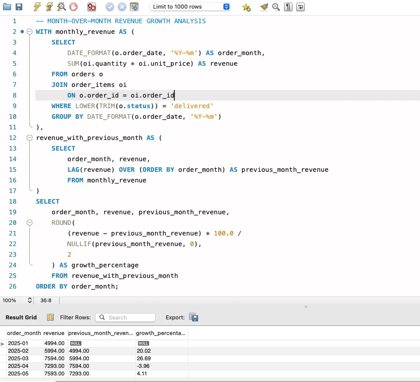

# E-commerce Business Performance Analysis

## Project Overview
This project analyzes e-commerce business performance using SQL and MySQL. The goal is to explore sales, product performance, customer purchasing behaviour, and order cancellations to generate insights that can support business decisions.

## Business Objectives
The analysis aims to answer the following questions:

1. What is the value of each customer order?
2. How does revenue change month over month?
3. Which products generate the highest revenue?
4. Which product categories perform best?
5. Which customers contribute the most revenue?
6. What percentage of orders are cancelled?
7. What is the average order value (AOV)?

## Database Structure
The project uses a relational database named `ecommerce_analysis` with four tables:

- **customers** – Customer details and location.
- **products** – Product names, categories, and prices.
- **orders** – Order dates, customer references, and order statuses.
- **order_items** – Products, quantities, and prices associated with each order.

## Tools & Skills Used
- MySQL
- MySQL Workbench
- SQL joins
- Aggregate functions (`SUM`, `COUNT`, `AVG`)
- `GROUP BY` and `ORDER BY`
- `CASE` statements
- Date functions
- Business data analysis

## Key Findings

Based on the sample dataset:

- **Total delivered revenue:** ₹33,468.
- **Order cancellation rate:** 13.33%.
- **Average order value:** ₹3,042.55 for delivered orders.
- **Delivery completion rate:** 73.33%.
- **Highest revenue month:** March 2025, generating ₹7,594.
- **Top-performing product:** Bluetooth Headphones, generating ₹5,997 from 3 units sold.
- **Top-performing category:** Accessories, generating ₹9,990 (29.85% of total revenue).
- **Highest-spending customer:** Meera Iyer, with delivered purchases worth ₹4,996.
- **Total registered customers:** 10.
- **Customers who made purchases:** 10.
- **Repeat customers:** 4.
- **Repeat customer percentage:** 40%.
  
## Project Files

| File | Description |
|---|---|
| `01_create_tables.sql` | Creates the database and tables. |
| `02_insert_sample_data.sql` | Inserts sample customer, product, and order data. |
| `03_business_analysis_queries.sql` | Contains SQL queries used for business analysis. |

## Project Outcome
This project demonstrates how SQL can be used to transform structured e-commerce data into meaningful business insights. It showcases practical analytical skills relevant to Business Analyst and Data Analyst roles.

-- =====================================================

### Category-wise Revenue Analysis

### Month-over-Month Revenue Growth

## Customer Analysis

### Customer Retention Analysis

This analysis evaluates customer purchasing behaviour and repeat purchases.

## Business Recommendations

Based on the analysis, the following business recommendations can help improve e-commerce performance:

1. **Strengthen Accessories Sales:** Accessories contribute 29.85% of total revenue. The business can maintain product availability and explore cross-selling opportunities to support continued sales.

2. **Improve Customer Retention:** With 40% of purchasing customers making repeat purchases, targeted loyalty programs, personalized offers, and follow-up campaigns could encourage more customers to return.

3. **Investigate Order Cancellations:** The order cancellation rate is 13.33%. Reviewing cancellation reasons could help identify operational issues and reduce avoidable cancellations.

4. **Improve Delivery Performance:** The delivery completion rate is 73.33%. Reviewing unsuccessful orders and identifying common delivery issues could help improve order fulfilment.

5. **Monitor Monthly Revenue Trends:** Revenue declined in April before recovering in May. Regular monthly monitoring can help identify changes early and support better sales planning.

*This is a portfolio project built using sample data for learning and demonstration purposes.*
