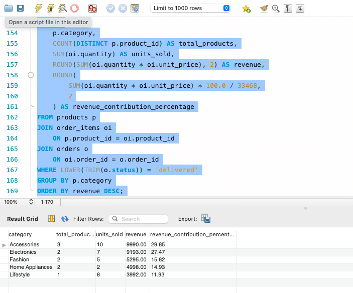
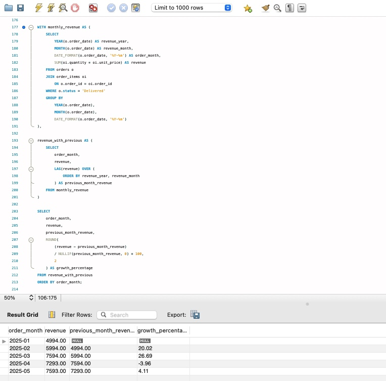
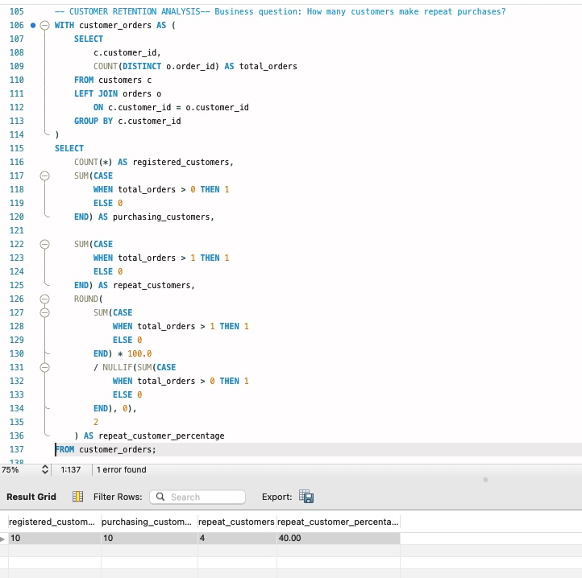

# E-commerce Business Performance Analysis

## Project Overview
This project analyzes e-commerce business performance using SQL and MySQL. The goal is to explore sales, product performance, customer purchasing behaviour, and order cancellations to generate insights that can support business decisions.

## Business Objectives
The analysis aims to answer the following questions:

1. What is the value of each customer order?
2. How does revenue change month over month?
3. Which products generate the highest revenue?
4. Which product categories perform best?
5. Which customers contribute the most revenue?
6. What percentage of orders are cancelled?
7. What is the average order value (AOV)?

## Database Structure
The project uses a relational database named `ecommerce_analysis` with four tables:

- **customers** – Customer details and location.
- **products** – Product names, categories, and prices.
- **orders** – Order dates, customer references, and order statuses.
- **order_items** – Products, quantities, and prices associated with each order.

## Tools & Skills Used
- MySQL
- MySQL Workbench
- SQL joins
- Aggregate functions (`SUM`, `COUNT`, `AVG`)
- `GROUP BY` and `ORDER BY`
- `CASE` statements
- Date functions
- Business data analysis

## Key Findings

Based on the sample dataset:

- **Order cancellation rate:** 13.33%.
- **Average order value:** ₹3,042.55 for delivered orders.
- **Top-performing product:** Bluetooth Headphones, generating ₹5,997 from 3 units sold.
- **Top-performing category:** Accessories, generating ₹9,990.
- **Highest-spending customer:** Meera Iyer, with delivered purchases worth ₹4,996.

## Project Files

| File | Description |
|---|---|
| `01_create_tables.sql` | Creates the database and tables. |
| `02_insert_sample_data.sql` | Inserts sample customer, product, and order data. |
| `03_business_analysis_queries.sql` | Contains SQL queries used for business analysis. |

## Project Outcome
This project demonstrates how SQL can be used to transform structured e-commerce data into meaningful business insights. It showcases practical analytical skills relevant to Business Analyst and Data Analyst roles.

-- =====================================================
-- 7. PRODUCT PERFORMANCE ANALYSIS
-- =====================================================

-- Category-wise revenue, units sold and revenue contribution

SELECT
    p.category,
    COUNT(DISTINCT p.product_id) AS total_products,
    SUM(oi.quantity) AS units_sold,
    ROUND(SUM(oi.quantity * oi.unit_price), 2) AS revenue,
    ROUND(
        SUM(oi.quantity * oi.unit_price) * 100.0 / 33468,
        2
    ) AS revenue_contribution_percentage
FROM products p
JOIN order_items oi
    ON p.product_id = oi.product_id
JOIN orders o
    ON oi.order_id = o.order_id
WHERE LOWER(TRIM(o.status)) = 'delivered'
GROUP BY p.category
ORDER BY revenue DESC;---

### Category-wise Revenue Analysis

### Month-over-Month Revenue Growth

### Month-over-Month Revenue Growth

## Customer Analysis

### Customer Retention Analysis

This analysis evaluates customer purchasing behaviour and repeat purchases.

Key findings:
- Total registered customers: 10
- Customers who made purchases: 10
- Repeat customers: 4
- Repeat customer percentage: 40%

*This is a portfolio project built using sample data for learning and demonstration purposes.*
